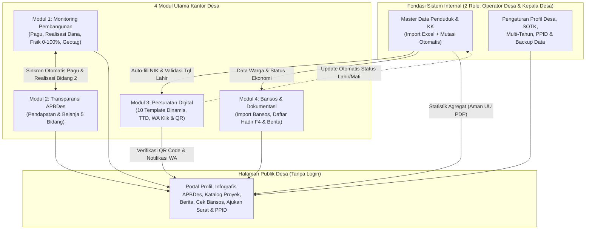
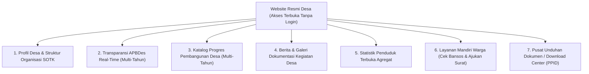

# RANCANGAN MODUL SISTEM INFORMASI & WEBSITE OPERASIONAL DESA

Dokumen ini memuat spesifikasi terpadu untuk **Sistem Operasional Internal Kantor Desa** (berbasis **2 Role Pengguna**, **Fondasi Master Data Kependudukan**, **4 Modul Operasional Utama**, **Manajemen Multi-Tahun Anggaran**, dan **Pengaturan Portal/PPID/Backup**) serta **1 Portal Halaman Publik Desa**.

---

## DAFTAR ISI
- [0. Hak Akses Pengguna (2 Role) & Fondasi Master Data Kependudukan](#0-hak-akses-pengguna-2-role--fondasi-master-data-kependudukan)
- [1. Modul 1: Monitoring Pembangunan Desa](#1-modul-1-monitoring-pembangunan-desa)
- [2. Modul 2: Transparansi Anggaran dan Penggunaan Dana (APBDes)](#2-modul-2-transparansi-anggaran-dan-penggunaan-dana-apbdes)
- [3. Modul 3: Administrasi dan Persuratan Digital Desa](#3-modul-3-administrasi-dan-persuratan-digital-desa)
- [4. Modul 4: Data Sosial (Bansos) dan Dokumentasi Kegiatan Desa](#4-modul-4-data-sosial-bansos-dan-dokumentasi-kegiatan-desa)
- [5. Halaman Publik: Portal Profil Desa, Layanan Mandiri, Berita & Pusat Unduhan](#5-halaman-publik-portal-profil-desa-layanan-mandiri-berita--pusat-unduhan)
- [6. Menu Pengaturan Profil Desa, SOTK, Dokumen PPID & Backup Data (Panel Internal)](#6-menu-pengaturan-profil-desa-sotk-dokumen-ppid--backup-data-panel-internal)

---

## 0. Hak Akses Pengguna (2 Role) & Fondasi Master Data Kependudukan

### A. Pembagian Hak Akses Pengguna (Simpel 2 Role Internal + 1 Publik)
Untuk menjaga kesederhanaan operasional di kantor desa tanpa perlu berganti-ganti banyak akun, sistem menggunakan **2 Role Login Internal** serta **1 Akses Publik**:

| No | Role Pengguna | Siapa yang Menggunakan | Hak Akses & Kewenangan |
|:---:|---|---|---|
| 1 | **Operator Desa** | Sekdes / Operator Desa / Staf Pelayanan | **Akses Penuh Operasional**: Mengelola Master Data Penduduk, Modul 1 (Pembangunan), Modul 2 (APBDes), Modul 3 (Persuratan), Modul 4 (Bansos & Dokumentasi Kegiatan), serta Pengaturan Profil Desa, SOTK, Upload Dokumen PPID & Backup Data. |
| 2 | **Kepala Desa** | Kepala Desa (dan BPD saat evaluasi) | **Dashboard Eksekutif (*Read-Only* & Cetak PDF)**: Memantau grafik serapan APBDes, progres fisik vs keuangan proyek beserta foto $0\%, 50\%, 100\%$, rekap surat keluar/masuk, dan data bansos langsung dari HP serta mencetak laporan tanpa risiko tidak sengaja mengubah/menghapus data. |
| 3 | **Pengunjung Publik** | Warga, Kecamatan, Pemkab, Kemendesa, Kemendagri, BPKP | **Tanpa Login**: Mengakses Halaman Publik Desa, melihat transparansi anggaran & proyek (beserta arsip lintas tahun), mengecek status bansos mandiri (tersensor), mengajukan permohonan surat dari rumah, dan mengunduh dokumen resmi desa. |

### B. Fondasi Master Data Kependudukan (Data Warga & Kartu Keluarga)
Berfungsi sebagai **sumber data tunggal (*Single Source of Truth*)** yang menyuplai otomatis **Modul 3 (Persuratan)**, **Modul 4 (Bansos)**, dan **Statistik Agregat di Halaman Publik**:
1. **Import & Export Massal via Excel (1x Klik)**:
   - Operator dapat mengimpor data penduduk dan Kartu Keluarga (KK) secara massal menggunakan template Excel (kompatibel dengan struktur kolom SIAK/Prodeskel) sehingga tidak perlu mengetik ribuan warga satu per satu saat sistem pertama kali digunakan.
2. **Data yang Dicatat**:
   - Nomor KK, NIK, Nama Lengkap, Tempat & Tanggal Lahir, Jenis Kelamin, Agama, Pendidikan, Pekerjaan, Status Perkawinan, Hubungan dalam Keluarga (Kepala Keluarga/Istri/Anak), Alamat Dusun/RT/RW, Status Kesejahteraan/DTKS, dan **Status Kependudukan** (*Aktif / Meninggal Dunia / Pindah Keluar*).
3. **Mutasi Otomatis Terintegrasi dengan Modul 3**:
   - Saat Operator menerbitkan **Surat Keterangan Kematian** di Modul 3, sistem otomatis mengubah status warga yang bersangkutan menjadi **Meninggal Dunia** di Master Penduduk. NIK yang berstatus meninggal otomatis terkunci agar tidak bisa disalahgunakan untuk pencetakan surat baru maupun penerimaan Bansos.
   - Saat menerbitkan **Surat Keterangan Kelahiran**, operator dapat langsung menambahkan data bayi ke dalam KK orang tuanya.

---

## 1. Modul 1: Monitoring Pembangunan Desa

### A. Masalah yang Diselesaikan:
- Pencatatan kegiatan fisik sering tersebar di catatan manual atau file Excel yang rawan hilang.
- Foto dokumentasi pekerjaan lapangan (titik 0%, 50%, 100%) menumpuk di galeri WhatsApp pribadi perangkat desa dan sulit dicari saat penyusunan LPJ.
- Sulit membandingkan antara persentase progres fisik di lapangan dengan jumlah dana yang sudah dicairkan/terserap.
- Saat ada rapat BPD atau pemeriksaan Kecamatan/Inspektorat, staf harus mengumpulkan data dari awal.

### B. Alur Penggunaan oleh Operator:
1. **Input Kegiatan Baru**: Saat kegiatan disahkan di APBDes atau akan dimulai, Operator mengklik tombol **"Tambah Pembangunan"**.
2. **Update Progres Fisik & Keuangan Berkala**: Operator mengupdate persentase pengerjaan fisik ($0\% - 100\%$), menginput **Realisasi Anggaran / Dana Terserap (Rp)**, mencatat kendala lapangan (jika ada), dan mengunggah foto perkembangan lapangan.
3. **Sinkronisasi Otomatis ke APBDes (Modul 2)**: Setiap pembaruan Pagu dan Realisasi Anggaran di Modul 1 otomatis memperbarui angka serapan *Bidang 2: Pelaksanaan Pembangunan Desa* pada Modul 2 sesuai Tahun Anggaran proyek.
4. **Penyelesaian**: Status otomatis berubah menjadi **Selesai** saat progres fisik mencapai $100\%$ dan foto hasil akhir diunggah.
5. **Pelaporan**: Operator atau Kepala Desa klik tombol **"Cetak Rekapitulasi (PDF)"** untuk langsung diprint ke kertas F4 sebagai bahan laporan ke BPD, Kecamatan, atau Inspektorat.

### C. Formulir Isian Data Proyek:
| No | Kolom Isian | Penjelasan / Contoh | Wajib Diisi |
|:---:|---|---|:---:|
| 1 | **Nama Kegiatan** | Contoh: *Pembangunan Rabat Beton Jalan Usaha Tani* | Ya |
| 2 | **Lokasi / Dusun** | Contoh: *Dusun Sukamaju, RT 02 / RW 01* | Ya |
| 3 | **Pagu Anggaran (Rp)** | Nilai dana proyek (Contoh: *Rp 55.000.000*) | Ya |
| 4 | **Realisasi Anggaran / Dana Terserap (Rp)** | Nominal dana yang sudah cair/terserap (Otomatis sinkron ke Bidang 2 Modul 2) | Ya |
| 5 | **Sumber Dana** | Dropdown: *Dana Desa (DDS)*, *ADD*, *Bantuan Keuangan*, atau *PADes* | Ya |
| 6 | **Tahun Anggaran** | Contoh: *2026* (Mendukung filter arsip lintas tahun) | Ya |
| 7 | **Volume / Ukuran Fisik** | Contoh: *Panjang 350 m x Lebar 2,5 m* | Opsional |
| 8 | **Waktu Pelaksanaan** | Target mulai & selesai (Hari kalender) | Opsional |
| 9 | **Pelaksana Kegiatan** | Contoh: *TPK Desa / Swakelola PKTD* | Opsional |
| 10 | **Titik Koordinat Lokasi (Geotag)** | Contoh: *-6.9175, 107.6191* (Atau klik titik peta lokasi proyek) | Opsional |
| 11 | **Catatan / Kendala Lapangan** | Contoh: *Tertunda 3 hari karena curah hujan tinggi* | Opsional |

### D. Fitur Update Progres & Dokumentasi:
- **Status Otomatis**: Progres $0\%$ = *Belum Dimulai*, $1-99\%$ = *Sedang Dikerjakan*, $100\%$ = *Selesai*.
- **Indikator Perbandingan Fisik vs Keuangan**: Menampilkan persentase progres fisik berdampingan dengan persentase serapan dana ($\frac{\text{Realisasi}}{\text{Pagu}} \times 100\%$).
- **Wajib 3 Titik Foto**: Foto Titik Nol ($0\%$), Foto Sedang Berjalan ($50\%$), dan Foto Hasil Akhir ($100\%$).
- **Output Cetak**: Tabel rekapitulasi resmi siap cetak format F4 lengkap dengan kolom tanda tangan Kepala Desa & Pelaksana Kegiatan.

---

## 2. Modul 2: Transparansi Anggaran dan Penggunaan Dana (APBDes)

> [!NOTE]
> **Harmoni dengan Aplikasi Siskeudes (Kemendagri/BPKP)**:
> Sistem ini **bukan pengganti Siskeudes**. Pembukuan teknis akuntansi, kuitansi belanja, dan pajak tetap berjalan di Siskeudes laptop bendahara. Modul 2 ini berperan sebagai **etalase transparansi & kontrol pimpinan** untuk menampilkan grafik ringkas yang bisa dicek Kepala Desa dari HP dan tayang di website resmi desa.

### A. Masalah yang Diselesaikan:
- Data keuangan hanya tersimpan di aplikasi Siskeudes laptop bendahara, sehingga Kepala Desa dan Sekdes sulit memantau sisa pagu anggaran secara cepat.
- Kebutuhan informasi transparansi saat rapat evaluasi BPD.
- Pembuatan baliho APBDes manual di percetakan yang memakan waktu dan biaya.

### B. Alur Penggunaan oleh Kantor Desa:
1. **Awal Tahun**: Operator memilih **Tahun Anggaran** dan menginputkan target **Pendapatan**, **Pembiayaan/SiLPA**, serta pagu **Belanja** berdasarkan Perdes APBDes tahun berjalan (cukup diinput 1 kali di awal tahun, atau diperbarui saat ada APBDes Perubahan). Data tahun-tahun sebelumnya tetap tersimpan rapi sebagai arsip.
2. **Sepanjang Tahun**:
   - Untuk **Bidang 2 (Pembangunan Desa)**: Angka realisasi belanja dapat ditarik/tersinkronisasi otomatis dari total `Realisasi Anggaran (Rp)` seluruh proyek fisik tahun berjalan di **Modul 1**.
   - Untuk **Bidang 1, 3, 4, dan 5**: Setiap ada realisasi belanja kegiatan per termin (Tahap I, II, III), Operator mencatat nominal yang terserap.
3. **Kapan Saja**: Kepala Desa atau Operator bisa melihat grafik persentase serapan, pos anggaran yang masih utuh, membandingkan antar-tahun anggaran, serta mencetak laporan rekapitulasi.

### C. Pos Data yang Dicatat:
- **Pendapatan Desa**: Dana Desa (DDS), Alokasi Dana Desa (ADD), PADes, Bagi Hasil Pajak & Retribusi Daerah (BHPRD), Bantuan Keuangan Provinsi/Kabupaten, Pendapatan Lain-lain, serta Pembiayaan (SiLPA).
- **Belanja Desa (5 Bidang Baku Permendagri No. 20/2018)**:
  1. *Bidang 1: Penyelenggaraan Pemerintahan Desa* (Siltap Kades/Perangkat, operasional BPD, RT/RW & kantor).
  2. *Bidang 2: Pelaksanaan Pembangunan Desa* (Infrastruktur fisik — *otomatis sinkron dengan Pagu & Realisasi di Modul 1*).
  3. *Bidang 3: Pembinaan Kemasyarakatan Desa* (Karang Taruna, PKK, keagamaan, kamling).
  4. *Bidang 4: Pemberdayaan Masyarakat Desa* (Pelatihan tani, bantuan bibit/modal BUMDes).
  5. *Bidang 5: Penanggulangan Bencana, Keadaan Darurat & Mendesak* (BLT Dana Desa & darurat bencana).

### D. Output yang Dihasilkan:
- **Dashboard Grafik Visual**: Diagram donat/batang serapan kas per bidang (Pagu vs Realisasi vs Sisa Anggaran) dilengkapi filter pemilih Tahun Anggaran.
- **Generator Banner/Baliho APBDes**: Desain infografis otomatis siap unduh/cetak ke format spanduk (resolusi tinggi) untuk dipasang di depan kantor desa.
- **Cetak Rekap Realisasi (PDF)**: Laporan semesteran/tahunan ukuran F4 untuk BPD dan Kecamatan.

---

## 3. Modul 3: Administrasi dan Persuratan Digital Desa

### A. Masalah yang Diselesaikan:
- Ketik manual di Microsoft Word lama dan rawan salah ketik NIK/nama.
- Nomor surat ganda atau terlewat di buku tulis manual saat kantor ramai.
- Pelayanan terhambat saat Kepala Desa sedang dinas luar apabila format tanda tangan surat tidak bisa diubah ke Sekretaris Desa (*a.n. Kepala Desa*).
- Pencarian arsip surat keluar maupun surat masuk memakan waktu lama saat ada pemeriksaan Kecamatan/Dinas.

### B. Alur Pelayanan Kilat di Loket (1–2 Menit Jadi):
1. **Warga Datang (atau dari Antrean Pengajuan Online)**: Warga datang membawa KTP/KK, atau Operator membuka daftar permohonan surat yang dikirim warga dari Halaman Publik.
2. **Pencarian Instan**: Operator mengetik NIK atau nama warga, seluruh biodata langsung terisi otomatis dari **Master Data Penduduk** tanpa perlu diketik ulang.
3. **Pilih Template, Isi Field Dinamis & Pilih Penandatangan**:
   - Operator memilih jenis surat, lalu mengisi **Kolom Khusus Dinamis** sesuai jenis surat (misal nama usaha untuk SKU) dan kolom keperluan.
   - Operator memilih **Pejabat Penandatangan**: **`Kepala Desa`** atau **`a.n. Kepala Desa - Sekretaris Desa`** (jika Kades sedang tugas luar).
4. **Cetak Langsung & Kabari via WA (1x Klik)**:
   - Sistem otomatis membuat nomor surat resmi sesuai kode klasifikasi dan mengisi template surat. Operator klik **Cetak**, surat keluar dari printer kertas F4 lengkap dengan QR Code verifikasi, siap distempel dan ditandatangani.
   - Jika surat berasal dari **Pengajuan Online Warga**, Operator cukup klik tombol **"Kabari Warga via WA"** (`wa.me` gratis tanpa biaya berlangganan API) yang otomatis membuka chat WhatsApp ke nomor warga: *"Halo Bpk/Ibu [Nama], Surat [Jenis Surat] Anda sudah selesai dicetak dan ditandatangani. Silakan diambil di Kantor Desa dengan membawa KTP/KK asli."*

### C. Daftar 10 Template Surat Resmi Baku & Kolom Isian Khususnya:
| No | Jenis Surat | Kode Klasifikasi | Kolom Isian Khusus Dinamis (Selain Biodata & Keperluan) | Kegunaan Umum Warga |
|:---:|---|:---:|---|---|
| 1 | **Surat Keterangan Usaha (SKU)** | `500` | *Nama/Jenis Usaha, Bidang Usaha, Lama Usaha, Alamat Lokasi Usaha* | Pengajuan pinjaman bank / KUR, izin usaha mikro |
| 2 | **Surat Keterangan Domisili** | `470` | *Sejak Tahun / Lama Tinggal di Desa, Status Tempat Tinggal* | Bukti tempat tinggal, persyaratan kerja/sekolah |
| 3 | **Surat Keterangan Tidak Mampu (SKTM)** | `400` / `460` | *Pekerjaan/Penghasilan Rata-rata, Nama Anak/Tanggungan (jika untuk sekolah)* | Pengajuan beasiswa, KIS/BPJS PBI *(cek otomatis bansos)* |
| 4 | **Surat Pengantar SKCK** | `300` | *Catatan Kelakuan Baik di Desa, Tujuan Pembuatan SKCK* | Permohonan SKCK ke Polsek / Polres |
| 5 | **Surat Keterangan Kematian** | `474.3` | *Hari/Tanggal/Jam Meninggal, Tempat Meninggal, Penyebab, Lokasi Makam, Nama Pelapor* | Pengurusan akta kematian, waris *(otomatis update status warga)* |
| 6 | **Surat Keterangan Kelahiran** | `474.1` | *Nama Bayi, Jenis Kelamin, Hari/Tgl/Jam/Tempat Lahir, Anak ke-, NIK Ayah & Ibu* | Pengurusan akta kelahiran di Disdukcapil *(bisa tambah warga baru)* |
| 7 | **Surat Keterangan Belum Menikah** | `474.2` | *Pernyataan Status Belum Pernah Menikah Secara Hukum/Agama* | Pendaftaran CPNS, TNI/Polri, persyaratan nikah |
| 8 | **Surat Keterangan Janda / Duda** | `474.2` | *Status (Cerai Hidup / Cerai Mati), Nama Mantan Pasangan, Sejak Tanggal/Tahun* | Keperluan administrasi keluarga / pensiun |
| 9 | **Surat Keterangan Kehilangan** | `300` | *Nama Barang/Dokumen yang Hilang, Perkiraan Waktu & Lokasi Kehilangan* | Pengantar laporan barang/dokumen hilang ke Polsek |
| 10 | **Surat Keterangan / Pengantar Umum** | `000` / `140` | *Isi Keterangan Tambahan Bebas (Paragraf Kustom)* | Keperluan dinas/administrasi warga lainnya |

### D. Fitur Pendukung Administrasi Desa (Sesuai Permendagri No. 47/2016):
- **Penomoran Otomatis Berpola, Anti-Kembar & Auto-Reset Tahunan**:
  - Format nomor surat otomatis mengikuti pola `[Kode Klasifikasi] / [Nomor Urut Otomatis] / [Kode Desa] / [Bulan Romawi] / [Tahun]` (Contoh: `470 / 024 / DS-SKM / X / 2026`).
  - **Reset Otomatis Tahun Baru**: Nomor urut surat otomatis kembali ke `001` setiap pergantian tahun (1 Januari), sementara arsip surat tahun-tahun sebelumnya tetap tersimpan utuh.
- **Format Cetak PDF Presisi Kertas F4**: Lengkap dengan Kop Surat Resmi Desa & **QR Code Arsip**.
- **Verifikasi Keaslian via QR Code**: Saat QR Code di surat dipindai menggunakan kamera HP, browser akan membuka halaman verifikasi resmi website desa yang menampilkan status **"SURAT ASLI & TERDAFTAR DI BUKU AGENDA DESA"** beserta Nomor Surat, Jenis Surat, Tanggal Terbit, Nama Warga (disamarkan sebagian, misal: *Budi S\*\*\*\**), dan Pejabat Penandatangan.
- **Buku Agenda Surat Keluar Digital**: Dilengkapi pencarian instan, filter per bulan/tahun, tombol cetak ulang surat, dan cetak buku agenda F4.
- **Buku Agenda Surat Masuk & Arsip Scan**: Tab khusus untuk mencatat surat yang masuk ke kantor desa (dari Kecamatan, Kabupaten, Undangan, dll.) meliputi *Nomor Surat Masuk, Tanggal Terima, Pengirim, Perihal, Tujuan/Disposisi*, serta fitur **Upload Foto/Scan PDF Surat Masuk** agar arsip fisik tidak hilang.

---

## 4. Modul 4: Data Sosial (Bansos) dan Dokumentasi Kegiatan Desa

### A. Masalah yang Diselesaikan:
- Polemik pembagian bansos di masyarakat karena data tersimpan di banyak file Excel terpisah tanpa riwayat tahun/tahap yang jelas.
- Kesulitan memasukkan ratusan daftar penerima bantuan dan mencetak daftar hadir tanda terima saat penyaluran bantuan di balai desa.
- Kegiatan-kegiatan nyata di desa (seperti pembagian bansos, posyandu, kerja bakti gotong royong) tidak terdokumentasi rapi dan tidak bisa dilihat oleh masyarakat luas maupun pemerintah pusat.

### B. Dua Fitur Utama Modul 4:

#### 1. Manajemen, Import & Pengecekan Data Bansos per NIK:
- **Import Massal Penerima Bansos via Excel**: Operator dapat mengunggah daftar penerima bantuan (PKH, BPNT, BLT-DD, dll.) secara massal menggunakan file Excel berbasis NIK agar tidak perlu menginput satu per satu.
- **Atribut Data Bansos Lengkap**:
  - Terhubung langsung ke NIK & Nomor KK di **Master Data Penduduk**.
  - **Jenis Bantuan**: PKH, BPNT/Sembako, BLT Dana Desa (BLT-DD), Bantuan RTLH (Bedah Rumah), PBI-JKN (KIS), atau Bantuan Daerah.
  - **Periode Penyaluran**: **Tahun Anggaran** (misal: *2026*) dan **Tahap / Bulan** (misal: *Tahap I / Triwulan 1*).
  - **Kategori Ekonomi / Desil**: *Terdaftar DTKS*, *Miskin Ekstrem (P3KE)*, *Rentan Miskin*, atau *Non-DTKS*.
  - **Status Kepesertaan**: *Aktif*, *Graduasi (Sudah Mampu)*, *Pindah*, atau *Meninggal Dunia* (otomatis nonaktif jika diterbitkan Surat Kematian di Modul 3).
- **Pengecekan Instan di Loket**: Saat warga datang ke loket (atau mengajukan SKTM di Modul 3), sistem langsung menampilkan riwayat bantuan sosial yang diterima warga tersebut beserta anggota keluarganya (1 KK).
- **Filter Pemerataan Bantuan**: Tombol khusus untuk memfilter daftar warga kategori kurang mampu (*DTKS / Miskin Ekstrem*) yang **belum pernah menerima bantuan apapun** pada tahun berjalan agar pembagian bantuan desa tepat sasaran dan adil.
- **Cetak Daftar Hadir & Tanda Terima Penyaluran Bansos (PDF Kertas F4)**: Fitur cetak tabel daftar penerima bantuan per Tahap/Jenis Bansos lengkap dengan kolom **Tanda Tangan / Cap Jempol Warga** dan pengesahan Kepala Desa sebagai bukti fisik lampiran LPJ penyaluran bantuan di balai desa.

#### 2. Manajemen Dokumentasi Kegiatan Desa (Untuk Halaman Publik) ⭐:
Operator desa mempublikasikan dokumentasi kegiatan kemasyarakatan dan kedinasan agar tayang di website resmi desa:
- **Formulir Dokumentasi Kegiatan**:
  - *Judul Kegiatan* (misal: *Penyaluran BLT Dana Desa Tahap I Tahun 2026 di Balai Desa*)
  - *Kategori Kegiatan*: Penyaluran Bansos, Posyandu & Kesehatan, Gotong Royong / Kerja Bakti, Musdes / Rapat Desa, Pelatihan Tani / BUMDes.
  - *Tanggal & Lokasi Dusun*
  - *Uraian / Cerita Ringkas Jalannya Kegiatan*
  - *Unggah Galeri Foto Kegiatan* (Upload 1 s/d 5 foto dokumentasi lapangan).
- **Opsi Status Publikasi (`Simpan sebagai Draft` vs `Terbitkan Langsung`)**:
  - **Simpan sebagai Draft**: Menyimpan dokumentasi di internal terlebih dahulu jika Operator masih menunggu kelengkapan foto atau ingin diperiksa Kepala Desa.
  - **Terbitkan Langsung (Published)**: Kegiatan langsung tayang di Halaman Publik desa untuk dilihat oleh warga, Kecamatan, dan Pemerintah Pusat.

---

## 5. Halaman Publik: Portal Profil Desa, Layanan Mandiri, Berita & Pusat Unduhan

Halaman ini dibuka bebas oleh **Masyarakat Umum, Kecamatan, Dinas Kabupaten, serta Pemerintah Pusat (Kemendesa, Kemendagri, BPKP)** melalui browser tanpa perlu login:

### A. Profil Resmi Desa & Struktur Organisasi (SOTK):
- Identitas desa lengkap (Kode Wilayah Kemendagri, alamat kantor, jam pelayanan, kontak email/WA pelayanan loket).
- Sambutan resmi Kepala Desa dan Visi-Misi Desa.
- Bagan struktur organisasi (SOTK): Foto, nama, dan jabatan Kepala Desa, Sekdes, BPD, Kaur/Kasi, dan Kepala Dusun.
- Sejarah singkat dan komoditas/potensi ekonomi unggulan desa.

### B. Transparansi & Data Terbuka (Otomatis dari Modul Internal + Filter Tahun):
- **Transparansi APBDes (dari Modul 2)**: Infografis grafik pendapatan vs belanja 5 bidang dilengkapi **pemilih Tahun Anggaran** + tombol unduh gambar baliho APBDes.
- **Katalog Pembangunan (dari Modul 1)**: Kartu proyek fisik dilengkapi filter **Tahun Anggaran**, perbandingan progres fisik vs dana terserap, foto 0%, 50%, 100%, lokasi dusun/peta, dan tombol unduh rekapitulasi.
- **Statistik Terbuka Agregat (dari Master Penduduk)**: Grafik jumlah jiwa, jumlah KK, rasio jenis kelamin, kelompok usia, pekerjaan, dan sebaran per dusun *(100% aman tanpa menampilkan NIK/nama individu sesuai UU PDP No. 27 Tahun 2022)*.

### C. Rubrik Berita & Galeri Dokumentasi Kegiatan Desa (dari Modul 4) ⭐:
- Menampilkan kartu-kartu kegiatan masyarakat yang berstatus *Published* lengkap dengan foto dokumentasi lapangan, tanggal, kategori, dan deskripsi acara.
- Menjadi **bukti otentik bagi masyarakat dan Pemerintah Pusat (Kemendesa / Kemendagri / BPKP)** bahwa program desa benar-benar terlaksana secara nyata di lapangan.

### D. Layanan Mandiri Warga (Dilengkapi Pengaman Verifikasi NIK + Tanggal Lahir):
1. **Cek Status Penerima Bansos Mandiri (Aman UU PDP)**:
   - Warga memasukkan **16 digit NIK** dan **Tanggal Lahir** (sebagai pengaman verifikasi) pada kolom pencarian.
   - Sistem hanya menampilkan hasil yang sudah disamarkan demi privasi, contoh: *"Nama: B\*\*\* S\*\*\*\*\* | Dusun Sukamaju | Terdaftar sebagai Penerima BLT Dana Desa Tahun 2026 (Status: Aktif)"* tanpa membocorkan detail anggota keluarga atau data sensitif lainnya.
2. **Pengajuan Surat Online dari Rumah (Terintegrasi Antrean Modul 3 & WA)**:
   - Warga memilih jenis surat yang dibutuhkan, memasukkan **NIK + Tanggal Lahir** (sistem memvalidasi kecocokannya dengan Master Penduduk agar tidak bisa diisi sembarangan oleh orang lain), memasukkan **Nomor HP/WA aktif**, serta mengisi keperluan surat.
   - Permohonan langsung masuk ke daftar antrean **Modul 3 Operator Desa**.
   - Setelah Operator memverifikasi, mencetak, dan meminta tanda tangan Kepala Desa/Sekdes, Operator menekan tombol **"Kabari Warga via WA"** sehingga warga tinggal datang ke kantor desa untuk mengambil surat yang sudah jadi tanpa mengantre lama.

### E. Pusat Unduhan Dokumen Resmi (Download Center / PPID Desa):
Memudahkan masyarakat maupun instansi pemerintah pusat/daerah mengunduh berkas legal desa kapan saja:
- **Arsip Regulasi & Laporan**: Perdes APBDes tahun berjalan, Laporan LPJ realisasi tahun lalu, Dokumen RKPDes & RPJMDes (format PDF).
- **Panduan Layanan Warga**: Brosur syarat kelengkapan berkas surat loket dan blangko isian formulir warga.

---

## 6. Menu Pengaturan Profil Desa, SOTK, Dokumen PPID & Backup Data (Panel Internal)

Agar **Operator Desa** dapat mengelola konfigurasi sistem dan memperbarui tampilan **Halaman Publik** kapan saja tanpa perlu mengubah kode program (tanpa bantuan programmer), tersedia menu pengaturan terpusat di dashboard internal:
1. **Pengaturan Identitas, Kop Surat & Pejabat Penandatangan**:
   - Input Nama Desa, Kecamatan, Kabupaten, Kode Kemendagri, Alamat, Nomor WhatsApp Pelayanan, Logo Kabupaten/Desa (otomatis menjadi Kop Surat Resmi di Modul 3 & Laporan F4).
   - Input Nama & NIP/NIAP **Kepala Desa** serta **Sekretaris Desa** (otomatis menjadi pilihan pejabat penandatangan di seluruh cetakan surat dan laporan).
2. **Pengaturan Tahun Anggaran Aktif**:
   - Mengatur tahun anggaran berjalan default (misal: *2026*) sekaligus membuka akses arsip data lintas tahun (2025, 2026, 2027, dst.) tanpa menghapus data tahun lama.
3. **Manajemen Perangkat Desa (SOTK)**:
   - Tambah/edit foto, nama, dan jabatan perangkat desa serta anggota BPD yang tampil di Halaman Publik.
4. **Manajemen Dokumen Unduhan (PPID / Download Center)**:
   - Fitur unggah (*upload*) berkas PDF resmi desa (Perdes APBDes, RPJMDes, RKPDes, SK, Panduan Layanan) beserta kategori dan tahun dokumennya untuk langsung tampil di Pusat Unduhan Halaman Publik.
5. **Keamanan & Unduh Backup Data Desa (1x Klik)**:
   - Tombol **"Unduh Backup Database (SQL) / Export Seluruh Data ke Excel"** agar Operator Desa dapat menyimpan cadangan data kependudukan, APBDes, proyek pembangunan, arsip agenda surat, dan bansos secara berkala ke laptop kantor desa.
